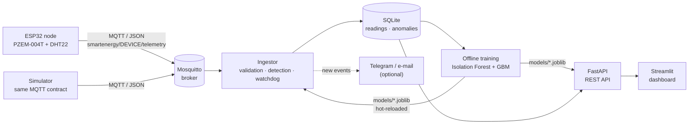

# Smart Energy AI – IoT & Machine Learning

[](https://smart-energy-ai.streamlit.app/)

**Live demo: [smart-energy-ai.streamlit.app](https://smart-energy-ai.streamlit.app/)**. Three
simulated ESP32 nodes publish over MQTT every 5 s, with anomalies injected at random. If the app is
asleep, click "Wake up" and allow 1–3 minutes for it to start.

End-to-end energy monitoring platform for buildings: **ESP32 sensor nodes measure electricity →
readings travel over MQTT → a Python pipeline validates and stores them → anomalies and sensor
faults are detected in real time → a model forecasts the next 24 h of consumption → a REST API
and a live dashboard show everything.**

The whole chain also runs without hardware: a simulator plays the role of the ESP32 nodes, with
realistic consumption and labelled anomalies, so the detectors can be measured against ground truth.

## Contents

1. [How it works in one minute](#1-how-it-works-in-one-minute)
2. [Architecture](#2-architecture)
3. [The life of a reading](#3-the-life-of-a-reading)
4. [Components in detail](#4-components-in-detail)
   [Firmware](#41-esp32-firmware) ·
   [Data contract](#42-data-contract-and-validation) ·
   [Simulator](#43-simulator) ·
   [Ingestor](#44-ingestor) ·
   [Storage](#45-storage) ·
   [Anomaly detection](#46-anomaly-detection) ·
   [Sensor health](#47-sensor-health-watchdog) ·
   [Forecasting](#48-consumption-forecasting) ·
   [Training](#49-training-and-evaluation) ·
   [API](#410-rest-api) ·
   [Dashboard](#411-dashboard) ·
   [Notifications](#412-notifications)
5. [Running the project](#5-running-the-project)
6. [Live demo](#6-live-demo)
7. [Connecting a real ESP32](#7-connecting-a-real-esp32)
8. [Configuration](#8-configuration)
9. [Results](#9-results)
10. [Project layout](#10-project-layout)
11. [Limitations, production notes and extensions](#11-limitations-production-notes-and-extensions)

---

## 1. How it works in one minute

* Each monitored circuit (a lab, an office, a server room) has an **ESP32** with a **PZEM-004T**
  meter (voltage, current, power, energy, frequency, power factor) and a **DHT22** (temperature,
  humidity). Every 5 s it publishes one JSON reading to an **MQTT broker** (Mosquitto).
* The **ingestor** subscribes to the broker. For every reading it checks the values, stores them in
  **SQLite**, and runs the **anomaly detector**. Detected problems become **events** (one event per
  incident, not one per reading). Every minute a **watchdog** also checks that each node is still
  sending complete data.
* **Training** is a separate, offline step. It learns each device's normal behaviour (an Isolation
  Forest for anomalies, gradient-boosting models for forecasting) and saves the models to `models/`.
  The ingestor and the API pick up new models automatically, without a restart.
* The **API** (FastAPI) serves readings, hourly consumption, anomaly events, sensor health,
  forecasts and model metrics. The **dashboard** (Streamlit) only talks to the API.

## 2. Architecture



| Process | Command | Role |
|---|---|---|
| Broker | Mosquitto (Docker or Windows service) | Routes messages between nodes and the backend |
| Ingestor | `python -m smart_energy.ingestor` | MQTT → validation → SQLite → live detection → events, plus watchdog |
| Simulator | `python -m smart_energy.simulator live` | Fake ESP32 nodes (skip it when real nodes publish) |
| Training | `python -m smart_energy.ml.train` | Offline: fits, evaluates and saves the models |
| API | `uvicorn smart_energy.api:app` | Read-only REST API over the database and the models |
| Dashboard | `streamlit run dashboard/app.py` | Live web interface |

## 3. The life of a reading

1. The ESP32 reads the PZEM-004T and the DHT22, builds a JSON payload and publishes it to
   `smartenergy/lab_a/telemetry`.
2. Mosquitto forwards it to every subscriber, here the ingestor (subscribed to `smartenergy/+/telemetry`).
3. The ingestor parses the JSON and validates it with Pydantic: identifier format, physical bounds,
   timestamp sanity. An invalid message is rejected, counted and logged; the pipeline goes on.
4. The reading is inserted into the `readings` table and appended to an in-memory window holding the
   last 30 readings of that device.
5. The detector scores the newest reading using that window: physical rules first, then the
   device's hour-of-week profile and its Isolation Forest.
6. If the reading is anomalous, the ingestor either **extends** the device's open event of the same
   kind (if the last occurrence was less than 5 min ago) or **opens** a new one. Only a new event
   triggers a log warning and a notification.
7. Separately, every 60 s, the watchdog looks at every known device: has it gone silent? Is its data
   over the last 24 h complete?
8. The dashboard polls the API every 5 s; the API reads SQLite and returns JSON.

## 4. Components in detail

### 4.1 ESP32 firmware

[`firmware/esp32_energy_node/esp32_energy_node.ino`](firmware/esp32_energy_node/esp32_energy_node.ino)

| Item | Detail |
|---|---|
| Hardware | ESP32 DevKit v1, PZEM-004T v3.0 (100 A, split-core CT), DHT22 |
| Wiring | PZEM TX → GPIO16 (RX2), PZEM RX → GPIO17 (TX2), PZEM 5 V → VIN; DHT22 data → GPIO4 with a 10 kΩ pull-up to 3.3 V |
| Libraries | PZEM004Tv30, PubSubClient, ArduinoJson v7, DHT sensor library (+ Adafruit Unified Sensor) |
| Configuration | `config.h` (copied from `config.h.example`, git-ignored): Wi-Fi, broker IP, `DEVICE_ID`, interval (5 s) |

Behaviours that matter for the backend:

* **Time**: the clock is synchronised by NTP in UTC. The `ts` field is only sent once NTP is synced;
  otherwise the server stamps the reading with its reception time.
* **Outage**: without mains voltage the PZEM returns `NAN` on every field. The firmware then sends
  zeros for voltage, current, power, frequency and PF, so the backend sees an outage.
  The energy counter stays `null` in that case.
* **Failed sensor**: any other `NAN` (for example an unplugged DHT22) is sent as `null`.
* **Last will**: at connection the node registers a retained `offline` message on
  `smartenergy/<id>/status`, then publishes `online`. If the node disappears without disconnecting
  cleanly, the broker publishes `offline` on its behalf.
* **Resilience**: Wi-Fi is retried for 20 s, then the board restarts; MQTT is retried every 5 s.

### 4.2 Data contract and validation

Telemetry topic `smartenergy/<device_id>/telemetry`:

```json
{"device_id":"lab_a","ts":1759480000,"voltage":231.2,"current":2.31,"power":480.5,
 "energy":123.456,"frequency":50.0,"pf":0.9,"temperature":24.5,"humidity":55.0}
```

Status topic `smartenergy/<device_id>/status`: `online` / `offline`.

Validation rules ([`smart_energy/schemas.py`](smart_energy/schemas.py)); every measurement is
optional and may be `null`:

| Field | Unit | Accepted range |
|---|---|---|
| `device_id` | – | 1–64 characters, letters, digits, `_` and `-` (taken from the topic if absent) |
| `ts` | Unix seconds, UTC | 2020-09 to now + 1 h; outside that (e.g. an unsynced clock in 1970) it is replaced by the reception time |
| `voltage` | V | 0–400 |
| `current` | A | 0–100 |
| `power` | W | 0–25,000 |
| `energy` | kWh (cumulative) | ≥ 0 |
| `frequency` | Hz | 0–70 |
| `pf` | – | 0–1 |
| `temperature` | °C | −40–85 |
| `humidity` | % | 0–100 |

### 4.3 Simulator

[`smart_energy/simulator.py`](smart_energy/simulator.py) produces data with the same contract as
the firmware, so the rest of the pipeline cannot tell the difference.

**Three simulated circuits.** HVAC is the extra power per °C above 24 °C:

| Device | Base load | Extra load when occupied | HVAC | Noise | Notes |
|---|---|---|---|---|---|
| `lab_a` | 350 W | 1,600 W | 140 W/°C | 5 % | cooling mostly when occupied |
| `office_b` | 120 W | 850 W | 90 W/°C | 6 % | cooling mostly when occupied |
| `server_room` | 2,200 W | 250 W | 110 W/°C | 2 % | cooled 24 h a day |

**How the consumption is built:**

* **Occupancy**: weekdays from 8:00 to 17:30 with a lunch dip at 13:00, Saturday morning at half
  occupancy, nobody on Sunday, plus 3 % standby. Times are Tunisian local time (UTC+1, no DST).
* **Outdoor temperature** (Sfax-like autumn): 24 °C on average, a ±6 °C daily cycle peaking
  mid-afternoon, and two slower waves of 3.7 and 9.3 days that imitate weather fronts.
* **Power** = (base + extra load × occupancy + cooling) × (1 + noise).
* **Grid**: voltage around 230 V with a small daily sag and noise, frequency 50 Hz ± 0.02.
* **Power factor** rises with the load; current is derived as P / (V × PF).
* **Indoor temperature and humidity** follow the outdoor temperature, the occupancy and the time of day.

**Two modes:**

* `backfill --days 60 [--step 60] [--seed 42] [--no-reset]` writes history directly into the
  database (one reading per minute by default). It injects anomalies and saves their labels to
  `data/labels.csv` (the ground truth used to evaluate the detector). By default it clears existing
  readings and events first.
* `live [--interval 5] [--anomaly-prob 0.01]` publishes over MQTT like a real node. At each tick,
  each device has a 1 % chance of starting an anomaly lasting a random number of ticks.

**Injected anomalies:**

| Kind | Backfill frequency | Duration | Effect |
|---|---|---|---|
| `spike` | ~every 2 days | 1–5 min | power × 2.5–4 |
| `night_load` | ~every 10 days | one night block (20:00–6:00) | + 60–90 % of the occupied load |
| `voltage_sag` | ~every 7 days | 5–20 min | voltage × 0.78–0.86 |
| `outage` | ~every 15 days | 10–60 min | V, I, P, f and PF at 0 |
| `stuck` | ~every 10 days | 30–120 min | every value frozen (sensor hang) |

### 4.4 Ingestor

[`smart_energy/ingestor.py`](smart_energy/ingestor.py)

* **Two threads.** The MQTT network loop runs in a background thread and calls `handle()` for each
  message. The main thread runs the watchdog every 60 s. A lock serialises both, because they share
  one SQLite connection.
* **Sliding window.** The last 30 readings of each device are kept in memory. The detector needs
  them: for example, a frozen sensor is only visible across 10 consecutive readings.
* **Event merging** (`db.upsert_event`). An anomalous reading extends the device's most recent event
  **of the same kind** when that event ended less than 300 s earlier; otherwise it opens a new
  event. A 2-hour outage is therefore one event with a start, an end, a peak power and a reading
  count, not 1,440 alerts. Because matching is per kind, two simultaneous problems (say a frozen
  sensor and a missing temperature) do not split each other into many events.
* **Hot reload.** Every 60 s the ingestor checks the modification time of `models/anomaly.joblib`
  and reloads it if training wrote a new one.
* **Robustness.** One bad message can never stop the subscriber: errors are logged and the loop
  goes on. If the broker is unreachable at startup, the ingestor retries every 5 s; after that, paho
  reconnects automatically.
* **Status messages.** A last-will `offline` immediately opens a `device_offline` event.

### 4.5 Storage

SQLite in WAL mode ([`smart_energy/db.py`](smart_energy/db.py)), so the ingestor can write while the
API reads.

| Table | Columns | Indexes |
|---|---|---|
| `readings` | `id`, `device_id`, `ts`, `voltage`, `current`, `power`, `energy`, `frequency`, `pf`, `temperature`, `humidity` | `(device_id, ts)`, `(ts)` |
| `anomalies` | `id`, `device_id`, `ts` (start), `end_ts`, `kind`, `score` (max Isolation Forest score), `power` (peak), `n_points`, `detail` | `(device_id, ts)` |

### 4.6 Anomaly detection

[`smart_energy/ml/anomaly.py`](smart_energy/ml/anomaly.py),
[`smart_energy/ml/features.py`](smart_energy/ml/features.py)

The detector combines three layers. Each one catches what the others miss.

**Layer 1: physical rules.** They need no training, so they protect a brand-new device from its
first reading. When several rules match, the first one in this table wins:

| Kind | Condition |
|---|---|
| `outage` | V < 50 V |
| `stuck_sensor` | P, I and V exactly constant (max − min = 0) over the last 10 readings |
| `voltage_sag` | V < 207 V (230 V − 10 %) |
| `voltage_surge` | V > 253 V (230 V + 10 %) |
| `meter_inconsistency` | \|P − V·I·PF\| / (P + 10) > 0.25 with V ≥ 50 V: the meter's own values contradict each other |

**Layer 2: hour-of-week profile (robust z-score).** During training, each device gets a profile of
168 slots (Monday 0:00 … Sunday 23:00). Each slot stores the **median** power and a robust spread,
1.4826 × MAD (median absolute deviation). The spread is floored at 3 % of the median (minimum
50 W), so quiet hours do not produce huge scores. For each reading:

```
z = (power − median of its hour-of-week) / spread
```

Medians and MAD are used instead of mean and standard deviation so that the anomalies already in the
history do not distort what "normal" looks like.

**Layer 3: Isolation Forest.** One forest per device (200 trees, 1,024 samples per tree) is trained
on the readings that pass the rules, using five features: z, log(1 + power), voltage, PF and the
consistency ratio. It flags unusual **combinations** that no single threshold sees. Its alert
threshold is the 99.5th percentile of its training scores.

**Final decision for a reading that passed the rules:**

* |z| > 6 → anomaly;
* or the forest flags it **and** |z| > 3 (the forest alone would raise too many noise alerts).

The result is `high_consumption` if z > 0, otherwise `low_consumption`.

A device unknown to the trained model (installed after the last training) gets the rules only. It
gets its own profile and forest at the next training.

### 4.7 Sensor health (watchdog)

[`smart_energy/health.py`](smart_energy/health.py)

The detector only runs when a message arrives. A dead node sends nothing, so it would never raise
an alert. The watchdog closes that gap by checking every known device once a minute:

| Event | Condition |
|---|---|
| `device_offline` | no reading for more than 120 s (`OFFLINE_AFTER_S`), or MQTT last-will `offline` received |
| `missing_field` | a reading contains `null` values (e.g. DHT22 unplugged). `energy` during an outage is ignored, since the PZEM cannot read it then |
| `data_gap_24h` | less than 90 % (`MIN_COMPLETENESS`) of the last 24 h covered by readings |

**How completeness is computed.**

1. The typical interval is the median gap between consecutive readings.
2. A gap counts as missing time only if it is longer than both 3 typical intervals and 120 s, that
   is, if the node would have been reported offline.
3. Completeness = 1 − missing time / window length.

Thanks to the 120 s condition, a node that switches from one reading per minute to one every 5 s is
not mistaken for a node losing data. Completeness is not judged during a node's first hour.

**Device status.** Each device gets one of three statuses:

* `offline`: it is not sending;
* `degraded`: completeness is below 90 %, values are missing, or there was a sensor-fault event in
  the window (`device_offline`, `missing_field`, `data_gap_24h`, `stuck_sensor`, `meter_inconsistency`);
* `ok`: none of the above.

While a problem lasts, the watchdog keeps extending the same event, so it is notified once.

### 4.8 Consumption forecasting

[`smart_energy/ml/forecast.py`](smart_energy/ml/forecast.py)

* **Target**: energy per hour (kWh) for each device, computed as the mean power over the hour
  divided by 1,000. Unlike differences of the cumulative counter, this does not depend on the
  sampling rate and survives a meter reset.
* **Features** for a target hour:

  | Group | Features |
  |---|---|
  | Calendar | hour, day of week, weekend flag, sin/cos of the hour (so that 23:00 and 0:00 are close) |
  | Lags | consumption 24, 48, 72, 168 (1 week) and 336 h (2 weeks) earlier |
  | Aggregates | mean of the same hour over the previous 7 days; mean and max of the day before |

* **Why every lag is at least 24 h**: the whole next day can be predicted in one pass, from data
  already known, without feeding predictions back in. Horizons longer than 24 h (up to 168 h) are
  produced 24 h at a time, using the previous chunk's predictions as history.
* **Models**: three `HistGradientBoostingRegressor` per device: the mean (squared error), and the
  10th and 90th percentiles (quantile loss) for an 80 % prediction interval.
* **Interval calibration** (conformalized quantile regression). The quantile models are fit on all
  data except the last 7 days. On those 7 days, the code measures how far the truth falls outside
  the band and widens the band by that margin (the 80 % quantile of the misses). The interval then
  reaches its 80 % target on new data instead of being over-confident. Raw quantile models covered
  only about half of the real values.
* **Prediction** starts at the current, partial hour. The band is forced to contain the mean
  forecast, and values are clipped at 0.
* **Minimum data**: a device needs at least 21 days of hourly data (14 days for the two-week lag,
  plus 7 test days) to get a forecaster. The API loads the last 21 days to forecast.

### 4.9 Training and evaluation

[`smart_energy/ml/train.py`](smart_energy/ml/train.py): `python -m smart_energy.ml.train`

1. Loads all readings from the database.
2. **Anomalies**: fits the profiles and forests. It then re-scores the whole history with the new
   model and **rewrites the `anomalies` table**, so past events always match the current model.
3. If `data/labels.csv` exists (simulated data), compares detections with the ground truth:
   * **point precision / recall / F1**: reading by reading;
   * **event recall**: a labelled incident counts as detected if at least one of its readings was flagged;
   * detections per anomaly kind.
4. **Forecasting**: for each device, holds out the last 7 days and compares the model with two naive
   baselines: "same hour yesterday" and "same hour last week". It reports MAE, RMSE, MAPE (ignoring
   near-zero hours such as outages), R² and the interval coverage. Then it refits the final models
   on all the data.
5. Saves `models/anomaly.joblib`, `models/forecast.joblib` and `models/metrics.json`.

Re-run training regularly (for example monthly, or after adding a device): the running ingestor and
API reload the new files by themselves.

### 4.10 REST API

[`smart_energy/api.py`](smart_energy/api.py). Interactive documentation (Swagger) is at
`http://localhost:8000/docs`.

| Endpoint | Returns |
|---|---|
| `GET /health` | time of the last reading and ingestion lag |
| `GET /devices` | each device's last reading, number of readings, online flag |
| `GET /health/devices?hours=24` | per device: status, last reading age, publish interval, completeness, missing values, sensor-fault events |
| `GET /readings/{device}?hours=6` | raw readings, downsampled to 2,000 points for charts |
| `GET /consumption/{device}?days=7` | hourly kWh |
| `GET /anomalies?device_id=&hours=168` | anomaly events with their duration |
| `GET /forecast/{device}?horizon=24` | hourly forecast (kWh, P10, P90) and total, up to 168 h |
| `GET /metrics` | evaluation results of the trained models |

The forecast endpoint returns `503` before the first training and `404` for a device without enough
history.

### 4.11 Dashboard

[`dashboard/app.py`](dashboard/app.py). It reads everything through the API and shows times in the
`Africa/Tunis` time zone. The sidebar lets you pick a device, the live window (1–48 h), the history
shown with the forecast (3–30 days) and the 5-second auto-refresh.

From top to bottom:

1. **Sensor health**: a red or orange banner for every offline or degraded node, and a table for
   all devices covering status, last reading, readings, interval, data received, missing values
   and sensor faults.
2. **KPIs**: power now, voltage, energy today, forecast for the next 24 h, anomaly events in 24 h.
3. **Live power** chart with a red diamond on each anomaly event.
4. **Anomaly log**: the 50 latest events with type, start, duration, peak power, reading count,
   score and detail.
5. **Hourly consumption & 24 h forecast**: history, forecast and the shaded P10–P90 band.
6. **Model evaluation** (expandable): forecasting metrics against the baselines, and detection
   metrics against the ground truth.

### 4.12 Notifications

[`smart_energy/alerts.py`](smart_energy/alerts.py). Every **new** event (anomaly or sensor fault)
can be pushed to Telegram and/or e-mail. Messages are sent from a background thread, so a slow
network never delays ingestion. Each channel stays disabled while its variables are empty (see
[Configuration](#8-configuration)).

```powershell
$env:TELEGRAM_BOT_TOKEN = "123456:ABC..."   # from @BotFather
$env:TELEGRAM_CHAT_ID   = "123456789"       # e.g. from @userinfobot
$env:ALERT_KINDS = "device_offline,missing_field,data_gap_24h,stuck_sensor,outage"   # optional filter
python -m smart_energy.ingestor
```

## 5. Running the project

### Windows, without Docker

You need an MQTT broker: either `docker compose up -d mosquitto` (with Docker Desktop running) or
[Mosquitto for Windows](https://mosquitto.org/download/) installed as a service.

```powershell
py -m venv .venv
.venv\Scripts\activate
pip install -r requirements.txt

python -m smart_energy.simulator backfill --days 60   # 60 days of history + ground-truth labels
python -m smart_energy.ml.train                       # train and evaluate both models
pytest                                                # run the test suite
```

Then start one service per terminal (each with the venv activated):

```powershell
python -m smart_energy.ingestor                       # 1. MQTT -> DB + live detection + watchdog
python -m smart_energy.simulator live                 # 2. fake ESP32 nodes (skip with real nodes)
uvicorn smart_energy.api:app --reload                 # 3. API -> http://localhost:8000/docs
streamlit run dashboard/app.py                        # 4. UI  -> http://localhost:8501
```

Run `backfill` again only when the history is old: the live view shows the last hours, so the
history should end close to now.

### Docker Compose

```powershell
docker compose up --build
```

[`docker-compose.yml`](docker-compose.yml) starts Mosquitto, a one-shot `init` service (backfill and
training, only if no model exists yet), the ingestor, the API (port 8000), the dashboard (port 8501)
and the simulator. Remove the `simulator` service when real nodes publish. `data/` and `models/`
are mounted volumes, so they survive restarts.

### Tests

`pytest` runs [`tests/test_pipeline.py`](tests/test_pipeline.py), 14 tests:

* few false alarms on clean data;
* injected outages, sags, spikes and frozen sensors are detected;
* an unknown device gets the rules only;
* event merging;
* forecast features never look at the last 24 h;
* the forecaster beats the naive baseline and its interval contains the mean;
* the ingestor works end to end, including invalid messages;
* the watchdog (offline, data gap, no duplicate alerts), missing values, last-will and completeness.

GitHub Actions runs them on every push ([`.github/workflows/ci.yml`](.github/workflows/ci.yml)).

## 6. Live demo

### Streamlit Community Cloud (free)

The public demo runs at **https://smart-energy-ai.streamlit.app/**.

[`streamlit_app.py`](streamlit_app.py) runs the whole stack behind a single Streamlit process with
simulated nodes:

* an internal Mosquitto broker, installed from [`packages.txt`](packages.txt);
* 60 days of history and model training;
* the ingestor, the API and the live simulator.

Only the dashboard is public. After a restart the page shows a progress screen for 1–3 minutes, and
services that crash are restarted automatically.

1. Push this repository to GitHub.
2. On [share.streamlit.io](https://share.streamlit.io), sign in with GitHub → **Create app** →
   **Deploy a public app from GitHub**.
3. Fill in:
   * repository: `<user>/smart-energy-ai`;
   * branch: `main`;
   * main file path: `streamlit_app.py`;
   * app URL: for example `smart-energy-ai`;
   * **Advanced settings**: Python 3.11.
4. **Deploy**. Every later push to `main` redeploys the app.

The app sleeps when nobody visits it for a while; a visitor wakes it up with one click. The data is
simulated and regenerated at each start.

### Docker (any host)

[`deploy/huggingface/`](deploy/huggingface/) packages the same demo as one container that exposes
only the dashboard, on port 7860:

```powershell
docker build -f deploy/huggingface/Dockerfile -t smart-energy-demo .
docker run --rm -p 7860:7860 smart-energy-demo        # -> http://localhost:7860
```

It also runs as a Hugging Face Docker Space, which now requires a PRO subscription:
`python deploy/huggingface/upload.py <hf-user>/smart-energy-ai` (token from `hf auth login` or `HF_TOKEN`).

## 7. Connecting a real ESP32

1. In the Arduino IDE, install the ESP32 board package and the libraries listed at the top of the `.ino`.
2. Copy `firmware/esp32_energy_node/config.h.example` to `config.h`, then set:
   * the Wi-Fi name and password;
   * a unique `DEVICE_ID`;
   * `MQTT_HOST` = the **LAN IP of the PC running Mosquitto** (`ipconfig`), not `localhost`.

   Allow port 1883 in the Windows firewall.
3. Wire the node as described in the header of the `.ino`.
   ⚠ The PZEM-004T is connected to 230 V mains: wire it with the power off and have it checked by
   a qualified person.
4. Flash the board and open the Serial Monitor (115200 baud). You should see `PUB {...}` lines, and
   the device appears in the dashboard.
5. To debug the broker: `mosquitto_sub -h localhost -t "smartenergy/#" -v`.

A new device is protected immediately by the rules (outage, voltage, frozen sensor, meter
inconsistency) and by the watchdog. After about 3 weeks of data, run
`python -m smart_energy.ml.train` again: the device gets its own profile, Isolation Forest and
forecaster, and the running services reload them.

## 8. Configuration

Every setting is an environment variable read by [`smart_energy/config.py`](smart_energy/config.py):

| Variable | Default | Meaning |
|---|---|---|
| `MQTT_HOST` / `MQTT_PORT` | `localhost` / `1883` | broker address |
| `MQTT_USER` / `MQTT_PASSWORD` | empty | broker credentials, if authentication is enabled |
| `TOPIC_PREFIX` | `smartenergy` | first level of the MQTT topics |
| `DATA_DIR` / `MODELS_DIR` / `DB_PATH` | `data/`, `models/`, `data/energy.db` | storage locations |
| `API_URL` | `http://localhost:8000` | where the dashboard finds the API |
| `OFFLINE_AFTER_S` | `120` | silence (s) after which a node is offline |
| `MIN_COMPLETENESS` | `0.9` | minimum share of the last 24 h covered by readings |
| `TELEGRAM_BOT_TOKEN` / `TELEGRAM_CHAT_ID` | empty | Telegram notifications |
| `SMTP_HOST` / `SMTP_PORT` / `SMTP_USER` / `SMTP_PASSWORD` | empty / `587` | e-mail server (port 465 = SSL, 587 = STARTTLS) |
| `ALERT_EMAIL_FROM` / `ALERT_EMAIL_TO` | `SMTP_USER` / empty | e-mail sender and recipient(s) |
| `ALERT_KINDS` | empty (all) | comma-separated event kinds to notify |

The nominal grid values (230 V ± 10 %, 50 Hz, as on the Tunisian STEG network) and the UTC+1 time
zone are constants in the code.

## 9. Results

Example run on 60 days × 3 devices of simulated 1-minute data (259,200 readings), produced by
`python -m smart_energy.simulator backfill --days 60 && python -m smart_energy.ml.train`. The
simulated history always ends at the current time, so the numbers change slightly from run to run.

**Anomaly detection** against the simulator's labels. The ranges come from two full runs.

| Metric | Example run | Range observed |
|---|---|---|
| Point precision | 98.6 % | 98.0–98.6 % |
| Point recall | 75.8 % | 74.5–75.8 % |
| Point F1 | 85.7 % | 84.7–85.7 % |
| Event recall (≥ 1 reading flagged) | 98.7 % | 96.6–98.7 % |

| Anomaly type | Detected events (example run) |
|---|---|
| Equipment left on overnight | 18/19 |
| Power outage | 15/15 |
| Power spike (1–5 min) | 69/70 |
| Frozen sensor | 20/20 |
| Voltage sag | 24/24 |

Where point recall is lost:

* **Frozen sensor**: the first 9 readings of each episode are missed by design, because 10
  identical readings are needed to confirm a freeze.
* **Overnight load on `server_room`**: about 90 % of those readings are missed. The extra load is
  only about 8 % of a 2.4 kW base (z ≈ 2.4), inside the normal noise of a single reading. It is
  fully caught on `lab_a` and `office_b`.

**Forecasting** (hourly kWh, last 7 days held out, example run):

| Device | Model MAE | Model MAPE | Baseline "yesterday" MAE | Baseline "last week" MAE | P10–P90 coverage |
|---|---|---|---|---|---|
| lab_a | 0.083 kWh | 10.7 % | 0.311 kWh | 0.121 kWh | 80 % |
| office_b | 0.050 kWh | 16.3 % | 0.182 kWh | 0.122 kWh | 92 % |
| server_room | 0.090 kWh | 3.7 % | 0.128 kWh | 0.177 kWh | 80 % |

The model beat the "yesterday" baseline on every device in every run. It usually beats "last week"
too, but on one run `lab_a`'s last-week baseline was slightly better (0.13 vs 0.15 kWh): a lab with a
strict weekly routine is almost a weekly repeat.

All these numbers come from simulated data. Re-run the training on real ESP32 data to report
real-world results.

## 10. Project layout

| Path | Role |
|---|---|
| `firmware/esp32_energy_node/` | Arduino firmware (PZEM-004T + DHT22, Wi-Fi, NTP, MQTT with last will) and `config.h.example` |
| `smart_energy/config.py` | Settings from environment variables |
| `smart_energy/schemas.py` | Pydantic validation of the telemetry payload |
| `smart_energy/db.py` | SQLite schema, inserts, event merging, queries |
| `smart_energy/simulator.py` | Multi-device simulator: history backfill with labels, live MQTT publishing |
| `smart_energy/ingestor.py` | MQTT subscriber: validation → storage → live detection → events, plus watchdog |
| `smart_energy/health.py` | Sensor health: online status, 24 h completeness, missing values |
| `smart_energy/alerts.py` | Optional Telegram / e-mail notifications |
| `smart_energy/ml/features.py` | Hour-of-week profiles, anomaly features, forecasting features |
| `smart_energy/ml/anomaly.py` | Hybrid detector (rules + robust z-score + Isolation Forest) and event building |
| `smart_energy/ml/forecast.py` | Day-ahead forecaster with calibrated P10/P90 intervals |
| `smart_energy/ml/train.py` | Training, evaluation, `metrics.json` |
| `smart_energy/api.py` | FastAPI REST API |
| `dashboard/app.py` | Streamlit dashboard |
| `streamlit_app.py`, `packages.txt` | Live demo on Streamlit Community Cloud |
| `deploy/huggingface/` | Same demo as a single Docker container |
| `docker-compose.yml`, `Dockerfile`, `mosquitto/` | Full stack with Docker Compose |
| `tests/test_pipeline.py` | pytest suite |
| `data/`, `models/` | Generated database and models (git-ignored) |

## 11. Limitations, production notes and extensions

**Known limitations**

* Small sustained shifts (a few percent of the load over hours) stay under the per-reading
  thresholds. A CUSUM or rolling-mean detector would catch them.
* SQLite and a single ingestor suit a building with a handful of nodes. Many nodes would call for
  TimescaleDB or InfluxDB.
* Detection quality has only been measured on simulated anomalies.

**Before a real deployment on the Internet**

The development setup trusts its network: Mosquitto accepts anonymous clients, and the API and the
dashboard have no login. For production:

* disable anonymous MQTT and give each node its own account;
* enable TLS on port 8883 (`WiFiClientSecure` in the firmware);
* put the dashboard behind HTTPS and a password, for example with a reverse proxy such as Caddy;
* keep the API internal;
* back up `data/energy.db`, and schedule the retraining.

**Possible extensions**

* Weather forecast (outdoor temperature) as an extra forecasting feature.
* CUSUM detector for small sustained shifts.
* OTA firmware updates.
* Comparing an LSTM or Temporal Fusion Transformer with the gradient-boosting model.
* Grafana dashboards on top of a time-series database.
